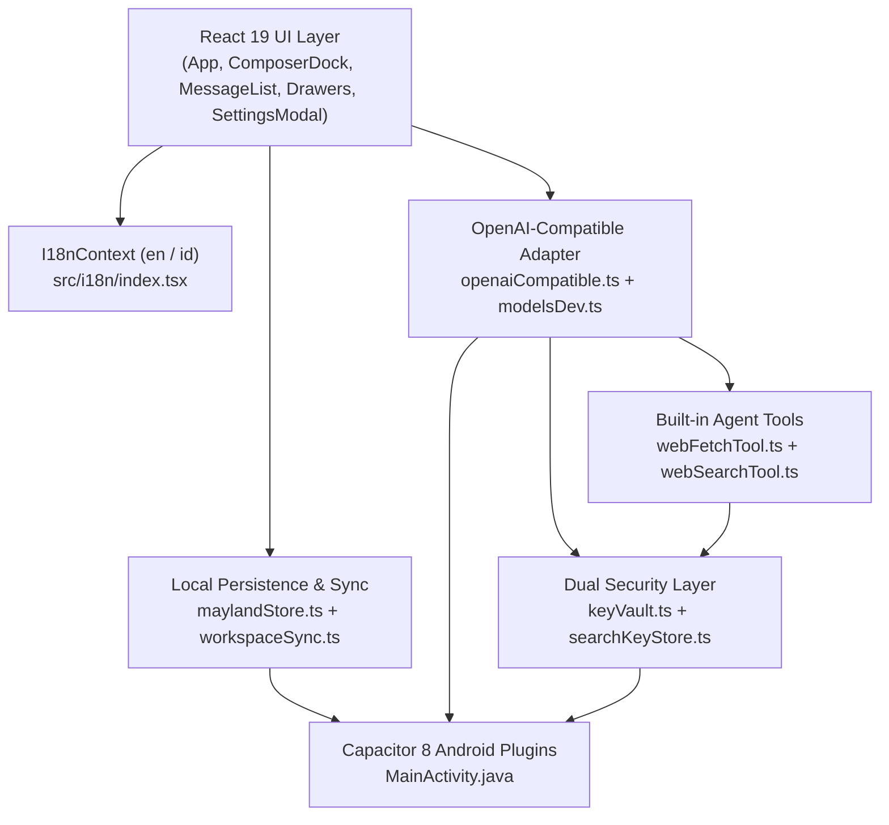

# Mayland Architecture

This document describes the current technical architecture of **Mayland** (`app.mayland.chat`), a mobile-first React + TypeScript + Capacitor 8 AI workbench supporting web/PWA and native Android builds.

---

## 1. High-Level System Architecture

Mayland is architected as a **client-first hybrid application**: all conversation state, UI rendering, OpenAI-compatible tool orchestration, and cryptographic secret wrapping run directly on the user's device, with native Capacitor Java plugins bridging Android-specific capabilities (hardware-backed Keystore encryption, unbuffered SSE streaming, atomic file persistence, and Android back/haptics/status-bar integration).

---

## 2. Source Code Layout & Responsibilities

| Layer | File(s) | Responsibility |
| :--- | :--- | :--- |
| **App Root & Lifecycle** | `src/App.tsx`, `src/main.tsx` | Coordinates active conversation state, theme/language application, request lifecycle (`idle`, `decrypting`, `connecting`, `thinking`, `streaming`, `error`), Android hardware back stack, and workspace hydration/sync. |
| **Domain Types** | `src/types/mayland.ts` | Defines `ProviderProfile`, `RunSettings`, `Attachment` (`'image' \| 'text' \| 'file'`), `ChatMessage`, `SearchProviderId`, `SearchKeyMetadata`, `WebSearchResult`, `AppLanguage`, `ThemeMode`, and vault metadata types. |
| **Internationalization** | `src/i18n/index.tsx` | Type-safe bilingual dictionary (`en` & `id`), React context (`I18nProvider`, `useI18n`), and language metadata (`LANGUAGE_OPTIONS`). |
| **State & Sync** | `src/store/maylandStore.ts`, `src/store/workspaceSync.ts` | Manages `localStorage` persistence (`mayland.*`), parameter defaults (`temperature: 1.0`, `maxTokens: null`, `webSearchEnabled: true`), bidirectional workspace snapshots, LAN PC sync, `.mayland.json` backup import/export, and cross-tab sync via `BroadcastChannel('mayland-sync')`. |
| **LLM Execution & Streaming** | `src/adapters/openaiCompatible.ts`, `src/adapters/providerPresets.ts`, `src/adapters/modelsDev.ts` | Payload serialization, parameter omission when set to `null`, SSE chunk parsing, reasoning extraction (`reasoning_content`, `reasoning`, `<think>` tags), `RollingTokenMeter`, multi-round tool loop (`MAX_TOOL_ROUNDS = 4`), cURL/`fetch` code generation, and model spec catalog (`models.dev`). |
| **Web Search & Fetch Tools** | `src/adapters/searchProviders.ts`, `src/adapters/webSearchTool.ts`, `src/adapters/webFetchTool.ts` | Normalized REST/JSON search execution across 8 monthly-free search APIs (`tavily`, `exa`, `brave`, `firecrawl`, `linkup`, `serpapi`, `parallel`, `langsearch`), plus `fetch_web` HTML/JSON extraction tool. |
| **Attachment Processing** | `src/utils/fileAttachments.ts` | Normalizes arbitrary uploaded files (`accept="*/*"` and `accept="image/*"`): raster images → `dataUrl`, text/code/UTF-8 → `textContent`, PDFs/binaries → `dataUrl` (`kind: 'file'`). |
| **Cryptography & Vaults** | `src/crypto/keyVault.ts`, `src/crypto/searchKeyStore.ts` | Encrypts LLM API keys locally (`AES-256-GCM` + IndexedDB key or PBKDF2-SHA256 Master PIN) and delegates Search API keys to `MaylandSecureVault` on Android or `keyVault` on web/PWA. |
| **UI Components** | `src/components/*` | Floating composer (`ComposerDock`), virtualized-window chat view (`MessageList`, `ThoughtsAccordion`, `TurnTimelineRail`), `RunSettingsDrawer`, `SettingsModal` + `SearchEngineSettingsPanel` + `SearchProviderLogos`, `WebSearchSheet`, `ProviderVaultSheet`, `ModelPickerSheet`, `HistoryVaultDrawer`, `Maybot`. |
| **Native Android Layer** | `android/app/src/main/java/app/mayland/chat/*.java` | Custom Capacitor plugins registered in `MainActivity.java`: `MaylandStoragePlugin`, `MaylandStreamPlugin`, and `MaylandSecureVaultPlugin`. |
| **Dev & Proxy Tooling** | `vite.config.ts` | Development/LAN middleware endpoints (`/__mayland_proxy`, `/__mayland_store`) and manual Rollup chunk splitting (`catalog-models`, `vendor-react`, `vendor-markdown`, `vendor-motion`, `vendor-icons`). |

---

## 3. Cryptographic Storage Boundaries

Mayland maintains two distinct secret storage paths, keeping plaintext API keys out of standard state sync and readable local files:

### A. LLM Provider Key Vault (`src/crypto/keyVault.ts`)
- **Algorithm**: WebCrypto `AES-256-GCM` with random 12-byte IV per record.
- **Storage**: Encrypted `EncryptedKeyEnvelope` objects are written to `localStorage` under `mayland.crypto.envelopes.v1`.
- **Key Modes**:
  1. **Device-Wrap (Default)**: A generated AES-256 key stored separately in IndexedDB (`mayland_keyvault_db` / `master_keys`).
  2. **Master PIN Mode**: Optional user PIN deriving a 256-bit AES key via `PBKDF2-SHA256` (`310,000` iterations, 16-byte random salt) verified against `MAYLAND_PIN_VERIFIER_OK_V1`.

### B. Search Engine Key Store (`src/crypto/searchKeyStore.ts` + `MaylandSecureVaultPlugin.java`)
- **On Android Native**:
  - `MaylandSecureVaultPlugin` creates/loads a non-exportable 256-bit AES-GCM key (`mayland_search_vault_master_v1`) directly inside `AndroidKeyStore` with `setRandomizedEncryptionRequired(true)` and inspects `KeyInfo` for hardware TEE/StrongBox backing.
  - Ciphertexts, IVs, masked previews, and 6-byte SHA-256 prefixes are stored exclusively inside app-private `SharedPreferences` (`Context.MODE_PRIVATE`, `mayland_secure_search_vault`).
- **On Web / PWA / Test Runtimes**: Falls back to `keyVault` (`AES-256-GCM`) under `search:<providerId>` namespace keys.
- **Sync Exclusion**: Search engine preferences (`activeProviderId`, `maxResults`) are synced via `workspaceSync.ts`, while search API keys are intentionally excluded from `.mayland.json` workspace snapshots.

---

## 4. Request Dispatch, Streaming & Tool Calling

1. **User Trigger**: `ComposerDock` collects prompt text and `attachments` (`image`, `text`, or `file`) and invokes `handleSend` in `App.tsx`.
2. **Payload Construction (`buildOpenAIPayload`)**:
   - Attaches `systemInstructions` as the initial `system` message if non-empty.
   - Formats multimodal user messages: text attachments are inlined as `[Attached File]` fenced blocks, PDF `file` attachments emit OpenAI/OpenRouter `{ type: 'file', file: { filename, file_data } }` parts, raster images emit `image_url` data URLs, and generic binary files append descriptive size/MIME notes.
   - Parameters `temperature` (default `1.0`), `top_p`, and `max_tokens` are **omitted from JSON payloads when set to `null` ("Off")**, letting providers apply model defaults and native maximum output ceilings.
   - Injects `fetch_web` and/or `search_web` definitions (`tool_choice: 'auto'`) when enabled and backed by saved credentials.
3. **Transport Layer**:
   - **Browser / Dev**: `fetch()` with `ReadableStream` SSE parsing (falling back through `/__mayland_proxy` when CORS blocks direct browser calls).
   - **Android Native**: Calls `MaylandStreamPlugin.startStream` over `HttpURLConnection` with `setReadTimeout(0)` to avoid socket drops during extended model thinking/prefill phases, emitting unbuffered Base64/UTF-8 stream events back to JS.
4. **Agentic Tool Loop**: If the model responds with `tool_calls` (`fetch_web` / `search_web`), `openAIAdapter.sendChat` executes the requested tool locally (logging tool activity into the reasoning trace), appends `role: 'tool'` results, and continues up to `MAX_TOOL_ROUNDS = 4`.

---

## 5. Native Android Project (`android/`)

- **Application ID**: `app.mayland.chat` (`minSdkVersion = 24`, `compileSdkVersion = 36`, `targetSdkVersion = 36`)
- **MainActivity (`MainActivity.java`)**: Registers `MaylandStoragePlugin`, `MaylandStreamPlugin`, and `MaylandSecureVaultPlugin`, and configures `#13161C` dark canvas WebView initialization.
- **Capacitor Plugins**: `@capacitor/app`, `@capacitor/haptics`, `@capacitor/keyboard`, `@capacitor/status-bar`.
- **Visual Assets**: Launcher icons (`mipmap-*/ic_launcher*.png`, `drawable-v24/ic_launcher_foreground.xml`, `values/ic_launcher_background.xml`) and splash assets (`drawable*/splash.png`) use the Mayland Pencil & Hand mascot over `#13161C`.

---

## 6. Cross-Device State & Workspace Sync

- **Browser Dev Mode**: `vite.config.ts` exposes `/__mayland_store` backed by `~/.mayland/workspace-state.json` (mode `0o600` atomic temp-file rename) and enumerates LAN IPv4 URLs for local Wi-Fi sync with the Android app.
- **Android Native Mode**: `MaylandStoragePlugin` persists JSON snapshots atomically (`tmp` + `getFD().sync()` + rename) inside Android internal `filesDir/mayland_workspace_state.json`.
- **Portable Backups**: Users can export/import `.mayland.json` files from **Settings → Storage**.
