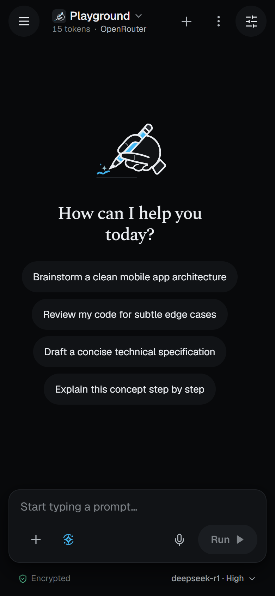
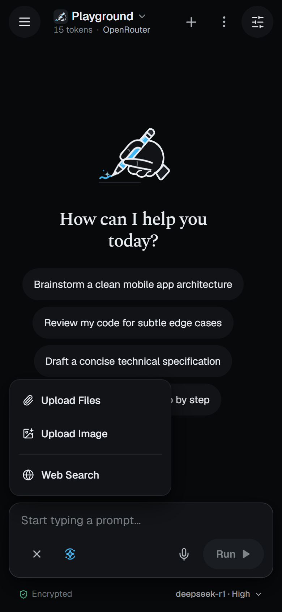
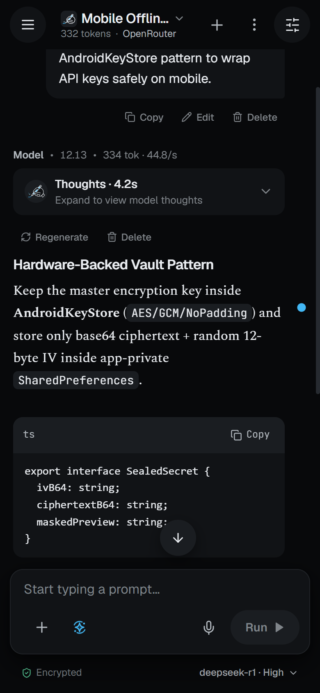
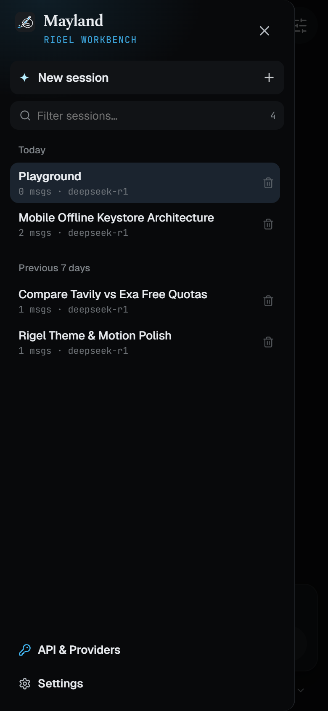
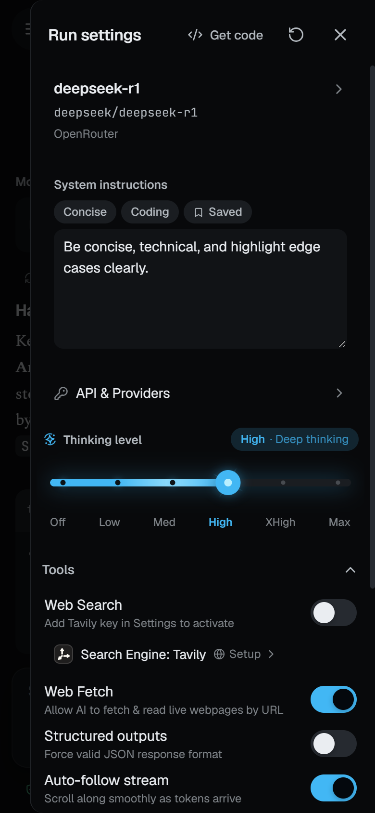
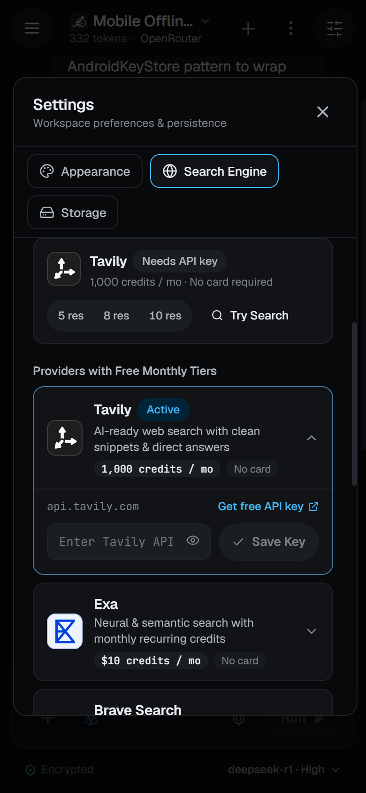
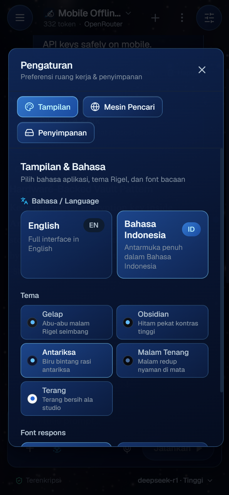
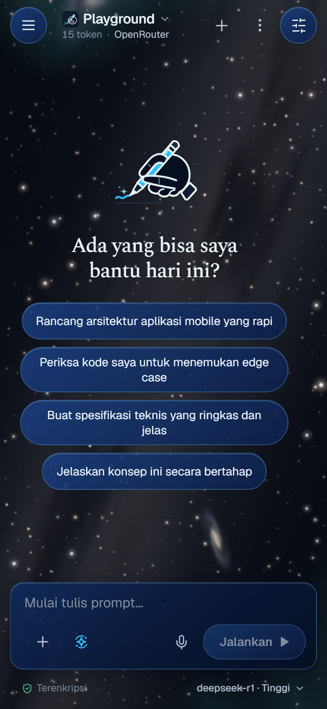

# Mayland

Mobile-first Personal AI Workbench built with React 19, TypeScript, Vite, and Capacitor 8 for web/PWA and Android.

Mayland brings OpenAI-compatible multi-provider control, live reasoning traces, flexible sampling parameters, multimodal/file uploads, and monthly-free web search APIs together inside an animated, portrait-friendly mobile interface with local encrypted key storage.

---

## Preview

Captured at mobile iPhone viewport resolution (`390×844` @2x). Full captions and details in [docs/PREVIEW.md](docs/PREVIEW.md).

| Home (Empty State) | Compact `+` Menu | Chat & Reasoning | Session Sidebar |
| :---: | :---: | :---: | :---: |
|  |  |  |  |

| Run Settings | Search Engine APIs | Bahasa Indonesia | Space Adventure Theme |
| :---: | :---: | :---: | :---: |
|  |  |  |  |

---

## Features

- **OpenAI-Compatible Multi-Provider Adapter**
  - Built-in presets for OpenRouter, Fireworks AI, Vercel AI Gateway, Groq, Together AI, DeepSeek, Ollama, and Custom endpoints (`src/adapters/providerPresets.ts`).
  - SSE streaming with live token/sec telemetry, reasoning extraction (`reasoning_content`, `reasoning`, `<think>` tags), collapsible `Thoughts` accordion, and `Get Code` snippet export.
- **Run Parameter Controls**
  - Live `EffortSlider` for reasoning effort (`off`, `low`, `medium`, `high`, `xhigh`, `max`).
  - Adjustable `Temperature` (default `1.0`), `Top P`, and `Max output tokens`, each with an `Off` toggle to omit the field and defer to provider/model defaults up to maximum model capability.
  - Structured output (`JSON`) mode and `fetch_web` URL reader tool (`src/adapters/webFetchTool.ts`).
- **Web Search Across 8 Monthly-Free Providers**
  - Supports **Tavily**, **Exa**, **Brave Search**, **Firecrawl**, **Linkup**, **SerpApi**, **Parallel**, and **LangSearch** (`src/adapters/searchProviders.ts`, `src/adapters/webSearchTool.ts`).
  - Includes a dedicated **Settings → Search Engine** panel with official provider logos (`src/components/SearchProviderLogos.tsx`), `Test Search`, direct `WebSearchSheet`, and AI `search_web` tool calling.
- **Clean Composer & File Uploads**
  - Compact `+` popover menu with **Upload Files** (any file type: images, code/text documents, PDFs, binaries), **Upload Image**, and **Web Search** toggle (`src/components/ComposerDock.tsx`, `src/utils/fileAttachments.ts`).
  - Passive active indicators on the composer bar when Structured Output (`{}`) or Web Search is enabled.
- **Local Secret Storage**
  - **LLM Provider Keys**: WebCrypto `AES-256-GCM` encryption with optional PBKDF2-SHA256 Master PIN (`src/crypto/keyVault.ts`).
  - **Search Engine API Keys**: Native `AndroidKeyStore` (`AES/GCM/NoPadding`, 256-bit) plugin stored in app-private `MODE_PRIVATE` `SharedPreferences` on Android (`android/app/src/main/java/app/mayland/chat/MaylandSecureVaultPlugin.java`), with WebCrypto fallback on web/PWA (`src/crypto/searchKeyStore.ts`).
- **Companion UI, Themes & Languages**
  - Animated chibi companion (`Maybot`), right-edge turn timeline rail, 5 themes (`dark`, `obsidian`, `space-adventure`, `space-night`, `light`), and bilingual UI support (**English** & **Bahasa Indonesia** via Settings).

---

## Documentation

- [docs/PREVIEW.md](docs/PREVIEW.md) — Mobile UI gallery across English, Bahasa Indonesia, Search Engine settings, and themes.
- [ARCHITECTURE.md](ARCHITECTURE.md) — Detailed system layering, cryptography boundaries, SSE streaming, tool-calling flow, and Android plugin architecture.
- [DESIGN.md](DESIGN.md) — Visual design system, OKLCH surface hierarchy, and interaction craft.
- [PRODUCT.md](PRODUCT.md) — Product positioning, UX principles, and mobile constraints.

---

## Tech Stack

- **Frontend**: React 19, TypeScript, Vite 6, Motion, Lucide Icons, `react-markdown`, `remark-gfm`
- **Mobile / Native**: Capacitor 8 (`@capacitor/android`, `@capacitor/app`, `@capacitor/haptics`, `@capacitor/keyboard`, `@capacitor/status-bar`), Java (Android Gradle Plugin, `minSdkVersion 24`, `targetSdkVersion 36`)
- **Testing**: Vitest 3

---

## Project Structure

```text
Mayland/
├── android/               # Capacitor Android project + MaylandSecureVaultPlugin.java
├── docs/                  # Mobile UI preview screenshots & gallery (docs/PREVIEW.md)
├── public/                # PWA manifest, service worker, favicon & mascot icons
├── src/
│   ├── adapters/          # OpenAI-compatible client, search providers & web tools
│   ├── components/        # Composer, drawers, modals, Maybot & Search UI
│   ├── crypto/            # Local AES-256-GCM vaults (provider keys & search keys)
│   ├── i18n/              # Bilingual English & Bahasa Indonesia localization
│   ├── store/             # Local conversation/settings store & workspace sync
│   ├── styles/            # Design tokens & global styling
│   ├── types/             # TypeScript domain models
│   └── utils/             # File attachments, token estimation & native bridge helpers
├── ARCHITECTURE.md
├── DESIGN.md              # Visual design system guidelines
├── LICENSE                # MIT License
├── PRODUCT.md             # Product architecture & principles
├── capacitor.config.ts    # Capacitor configuration (app.mayland.chat)
├── package.json
└── vite.config.ts
```

---

## Getting Started

### Prerequisites

- **Web / PWA development**:
  - Node.js (v20+ recommended) and `npm` (or `pnpm`)
- **Android APK builds**:
  - **JDK 21** (required by Capacitor 8 / Android toolchain; ensure `JAVA_HOME` points to JDK 21)
  - Android SDK (`compileSdkVersion 36`, `minSdkVersion 24`)

### Install & Run Web App

```bash
npm install
npm run dev
```

### Run Unit Tests & Production Build

```bash
npm test
npm run build
```

### Sync & Build Android Debug APK

```bash
npm run cap:sync
```

Then compile the APK (make sure `JAVA_HOME` uses JDK 21 and `android/local.properties` points to your local Android SDK):

```bash
# macOS / Linux
cd android
./gradlew assembleDebug
```

```powershell
# Windows PowerShell
$env:JAVA_HOME = "C:\Path\To\jdk-21"
cd android
.\gradlew.bat assembleDebug
```

Generated debug APK output: `android/app/build/outputs/apk/debug/app-debug.apk`.

---

## License

Licensed under the [MIT License](LICENSE).

