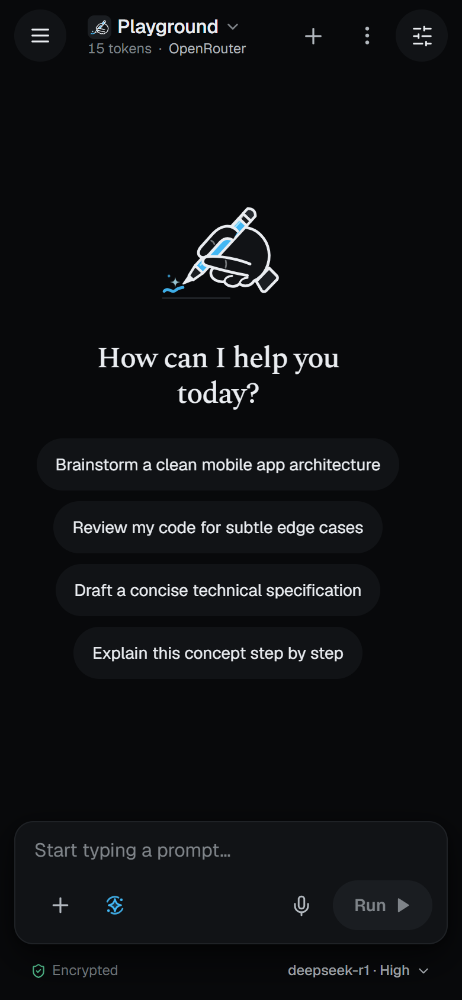
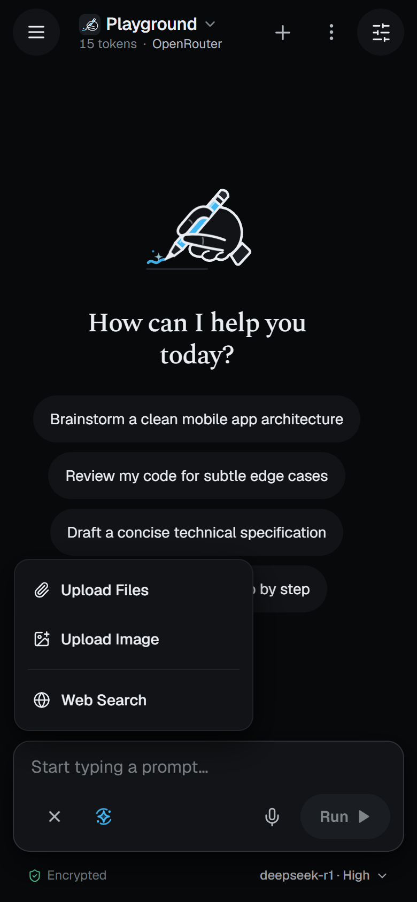
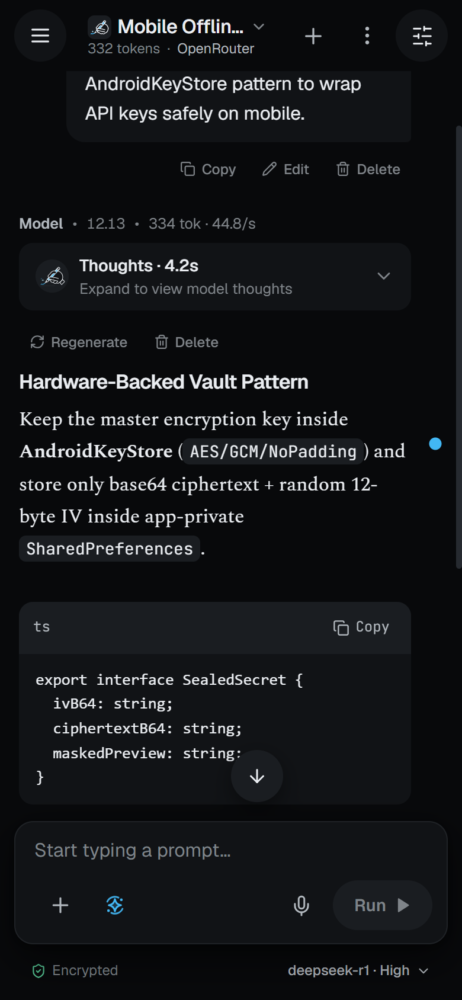
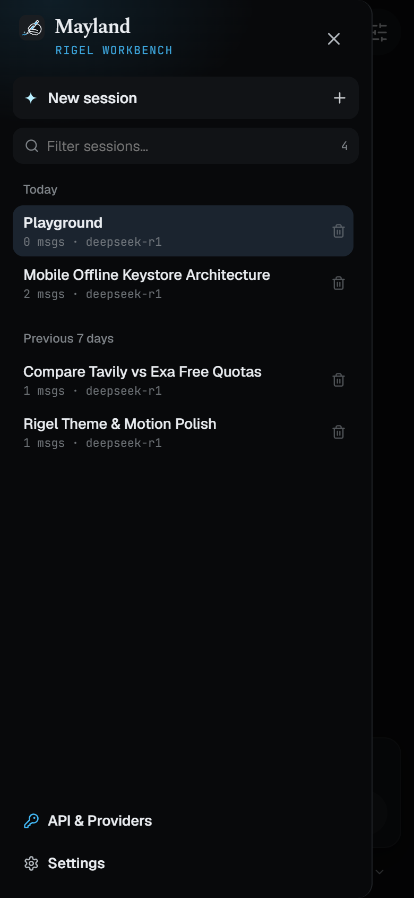
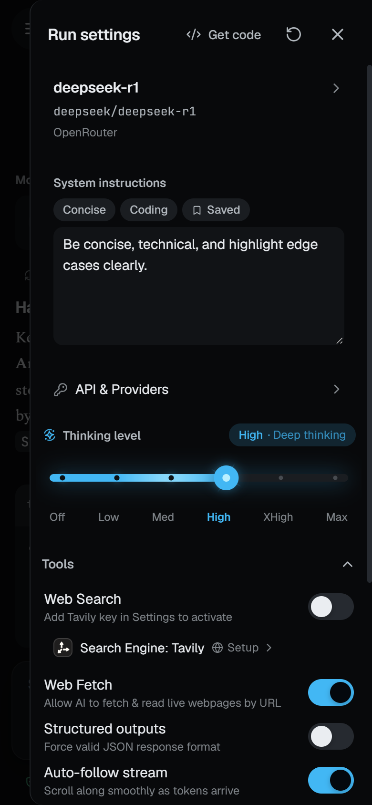
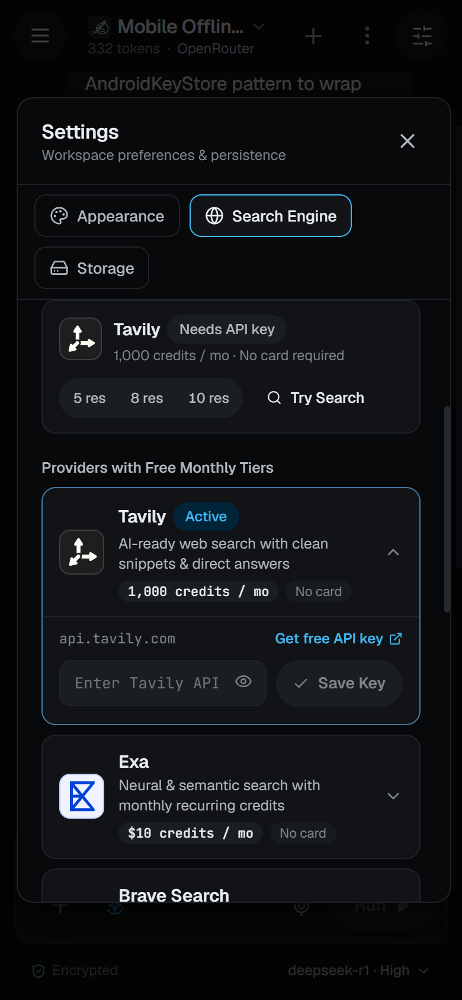
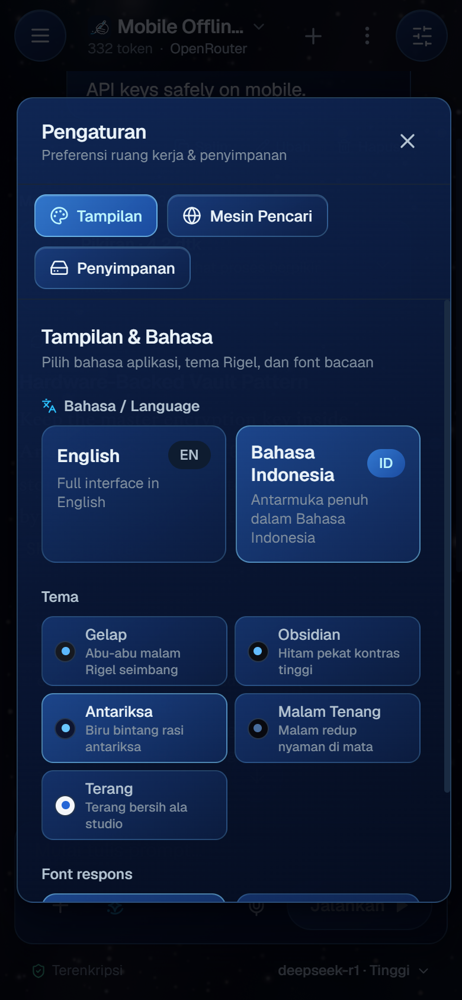
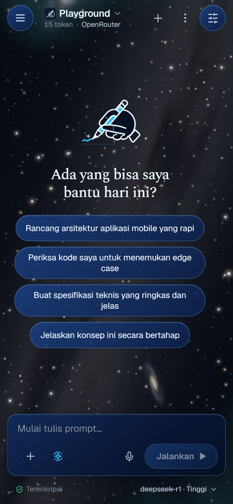

# Mayland Mobile UI Preview

All screenshots below were captured at mobile iPhone viewport resolution (`390×844` CSS px, `2x` DPR / `780×1688` px) against the production bundle using synthetic showcase conversations and metadata.

---

## Core Chat & Composer

| Screen | Description |
| :--- | :--- |
|  | **Home / Playground (`Dark` theme)**: Features the Mayland Pencil & Hand mascot, Editorial Serif prompt starters, clean `+` and `Reasoning` composer controls, and live encrypted vault / model status footer. |
|  | **Compact `+` Popover**: Anchored directly above `+`, exposing **Upload Files** (any file type including images, PDFs, code, binaries), **Upload Image**, and the **Web Search** quick toggle. |
|  | **Chat & Reasoning Trace**: Editorial Serif responses with collapsible `Thoughts` duration badge, syntax-formatted code blocks with one-tap copy, token/throughput metrics (`tok/s`), and right-edge turn timeline rail. |
|  | **History & Observatory Drawer**: Temporal session grouping (`Today`, `Previous 7 days`), live conversation filter, and clean **API & Providers** / **Settings** dock. |

---

## Settings, Search Engines & Themes

| Screen | Description |
| :--- | :--- |
|  | **Run Settings Drawer**: Model selector, System Instructions presets, Rigel glowing **Thinking level** slider, **Web Search** / **Web Fetch** / **Structured outputs** switches, and `Temperature` / `Top P` / `Max output tokens` (`Off` provider-default support). |
|  | **Search Engine Providers**: Dedicated directory of 8 free-monthly Search APIs (**Tavily**, **Exa**, **Brave Search**, **Firecrawl**, **Linkup**, **SerpApi**, **Parallel**, **LangSearch**) with official provider logos, quick key storage, and encryption verification. |
|  | **Bahasa Indonesia & Appearance**: Bilingual **English / Bahasa Indonesia** switcher in Settings alongside all 5 Rigel themes (`Gelap`, `Obsidian`, `Antariksa`, `Malam Tenang`, `Terang`) and reading font cards. |
|  | **Space Adventure Theme (Indonesia)**: Full Bahasa Indonesia experience over the animated starfield & frosted blue Rigel surface palette. |
